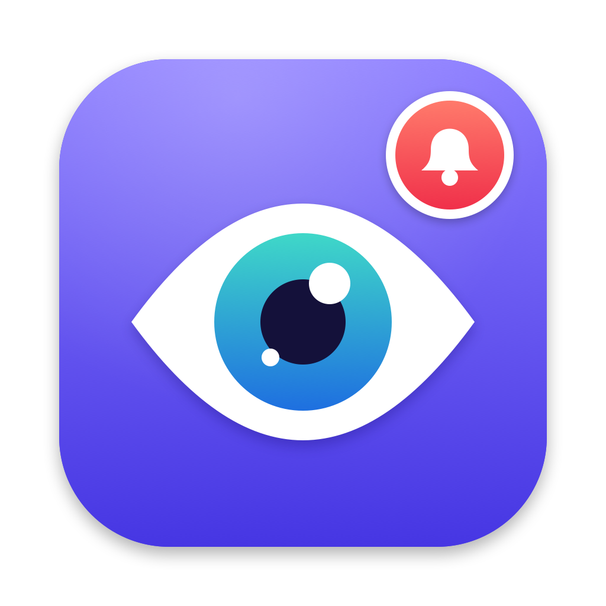

<p align="center"></p>

<h1 align="center">Notify Me</h1>

A tiny macOS menu-bar app that watches a window or screen area and plays a sound + notification when it changes. Handy for waiting on things that don't notify you themselves.

## Use

1. Press **⌃⌥⌘W**. The screen dims.
2. **Drag** to watch an area, or **click** a window to watch it. **Esc** cancels.
3. A red outline marks what's watched. When it changes you hear a sound and get a notification.
4. Press **⌃⌥⌘W** again to stop early.

Needs **Screen Recording** permission (System Settings → Privacy & Security). macOS 14+.

## Install

Requires macOS 14+ and the Xcode Command Line Tools (`xcode-select --install`).

```sh
git clone https://github.com/WsMonty/notify-me.git
cd notify-me
./deploy.sh
```

`deploy.sh` pulls the latest code, builds the app, installs it to `/Applications` and launches it.
The first build creates a self-signed certificate called **NotifyMe Local Signing** in your login keychain.
Signing with it keeps the Screen Recording permission across rebuilds, so you grant it only once.

## Updates

Notify Me checks GitHub for a new version on launch and once a day. When one is out, you get a
notification and the menu bar shows **Update to vX…**. Click it to run `deploy.sh` in Terminal,
or run it yourself:

```sh
cd notify-me && ./deploy.sh
```

**Check for Updates** in the menu checks right away.

## Build without installing

```sh
./build.sh && open NotifyMe.app
```

Sensitivity knobs are at the top of `main.swift`.

## Releasing a new version

Users are notified about new **tags**, not every commit:

```sh
git tag v1.1.0 && git push origin v1.1.0
```

## License

MIT, see [LICENSE](LICENSE).
